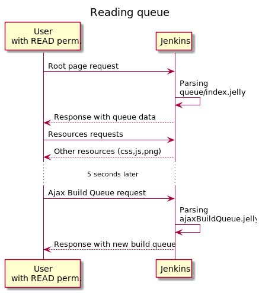
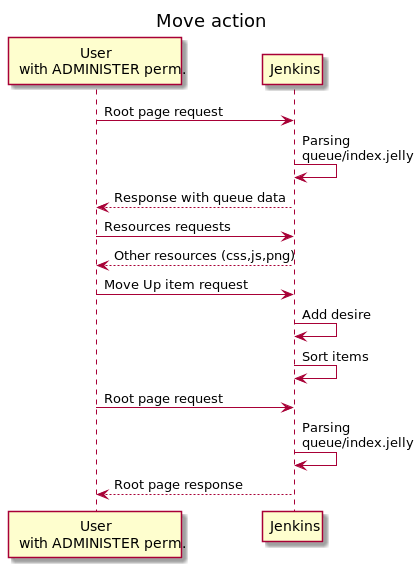
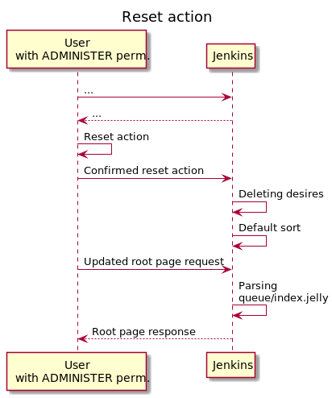

# For plugin developers
This section is intended for people who want to further extend this plugin.

## Testing build
```
mvn hpi:run
```
## Performing release
Always test connection before release.
Testing connection: ssh -T git@github.com

Release: 
```
mvn release:prepare
mvn release:perform
```
Do not forget to update docs if needed
```
cd docs_src/
mkdocs build
cd  ..
git rm -rf docs
mv  docs_src/site docs
git add docs
```
Once pushed, they will appear in https://jenkinsci.github.io automagically

Feel free to run `mvn spotless:apply` from time to time to align codestyle and formatting

## Documentation
The documentation framework used is mkdocs.
To see the documentation before publishing use 'pip install mkdocs-material' followed by 'mkdocs serve'

## How it works inside




## Jenkins Queue overview

> This plugin supports management of "Buildable Queue Items".

What does this statement technically mean?

### Jenkins queue architecture

In Jenkins, `QueueItem` and `Queue.BuildableItem` represent
different levels of specificity in the build queue. Queued items
typically spend most of their time in the blocked and/or buildable
state, and quickly pass others to produce a `Run` (if they are not
canceled before):
- The `QueueItem` is a general-purpose Java interface representing
  an item in any stage of the Jenkins queue.
- The `Queue.BlockedItem` is a concrete class (implementation)
  representing an item that Jenkins has a reason not to run yet.
  Even a free executor won't necessarily help. For example, jobs
  may be configured to forbid concurrent runs, or additional plugins
  like Build Blocker or Throttle Concurrent Builds can be used to
  similar effect by implementing `QueueTaskDispatcher.canRun()`.
- The `Queue.BuildableItem` is a concrete class (implementation)
  representing an item that has passed the initial waiting period
  and is eligible for execution (all scheduling conditions are
  satisfied), but is still waiting for an available executor (e.g.
  when there are no suitable workers are available at the moment).
- There are other implementations of this interface, see the
  diagram below for standard ones.

Jenkins queue items move through several stages:

```
              schedule()
                  |
                  v
             WaitingItem
            (quiet period)
                  |
                  v
             BlockedItem
           (cannot run yet)
                  |
                  v
            BuildableItem
       (ready, needs executor)
                  |
                  v
               Pending
        (assigned to executor)
                  |
                  v
               Running
(a Run may appear, QueueItem is removed)
```

Note one subtlety: Jenkins queue objects are snapshots of a
particular stage in an item's lifecycle. An item may transition
between stages while your code is inspecting it. The queue ID is
designed to remain stable across those transitions, and even into
the resulting `Run` (see `Run.getQueueId()`). That makes the
`QueueItem.getId()` particularly useful for tracking a build
across its lifecycle.

Also note that if a job requires multiple stages with a `node`
(or `agent` in Declarative), additional QueueItems appear named
like "part of BUILD_NAME". In case of simultaneous independent
runs, or `parallel` step used to run pipeline stages on different
nodes at the same time, you can end up with multiple such queue
items -- each with a separate priority that can be managed with
this plugin, and with its own conditions evaluated to go from
"buildable" to "running" (e.g. as executors on those nodes pick
up a new piece of work).

### Queue investigation and troubleshooting

You can inspect the active queue using your Jenkins scripting console:
```groovy
import hudson.model.Queue
import jenkins.model.Jenkins

def now = System.currentTimeMillis()

Jenkins.instance.queue.items.each { item ->
    def age = (now - item.inQueueSince) / 1000

    println """
${item.task.fullDisplayName}
  ID:        ${item.id}
  Type:      ${item.class.name}
  Age:       ${age}s
  Blocked:   ${item.blocked}
  Buildable: ${item.buildable}
  Stuck:     ${item.stuck}
  Why:       ${item.why}
"""
}
```

To monitor the time spent by objects in the queue, you could
use existing metrics in the Metrics plugin, including
`jenkins.task.blocked.duration`, `jenkins.task.buildable.duration`,
`jenkins.task.waiting.duration` and `jenkins.task.queuing.duration`.

Alternatively, you can dig through `QueueListener` callbacks
exposed by Jenkins (e.g. if you suspect a systemic problem),
including `onEnterWaiting`, `onLeaveWaiting`, `onEnterBlocked`,
`onLeaveBlocked`, `onEnterBuildable` and `onLeaveBuildable` -- but
this would probably require that you write a small plugin dedicated
to this investigation.

## Queue item comparison and sorting

For general authoritative reference, see:

* https://javadoc.jenkins-ci.org/hudson/model/queue/QueueSorter.html
* https://javadoc.jenkins-ci.org/hudson/model/Queue.Item.html
* https://javadoc.jenkins-ci.org/hudson/model/Queue.BlockedItem.html
* https://javadoc.jenkins-ci.org/hudson/model/Queue.BuildableItem.html
* https://docs.oracle.com/en/java/javase/21/docs/api/java.base/java/util/Comparator.html

Given the different `QueueItem` family life cycles, Jenkins has dedicated
`QueueSorter.sortBlockedItems()` and `QueueSorter.sortBuildableItems()`
methods for stages they spend most time in.

Jenkins has a special default queue item comparator,
`QueueSorter.DEFAULT_BLOCKED_ITEM_COMPARATOR`, which sorts by time
spent in the queue -- it compares Items based on `getInQueueSince()`
and in turn according to `buildableStartMilliseconds` for items derived
from https://javadoc.jenkins-ci.org/hudson/model/Queue.NotWaitingItem.html.

Jenkins allows to define extension points, including implementations
of `QueueSorter`, which can be effectively stacked when multiple queue
sorting plugins are installed, as well as default behavior -- see the
`originalQueueSorter` in this plugin's implementation.
